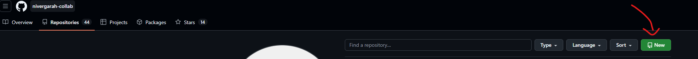
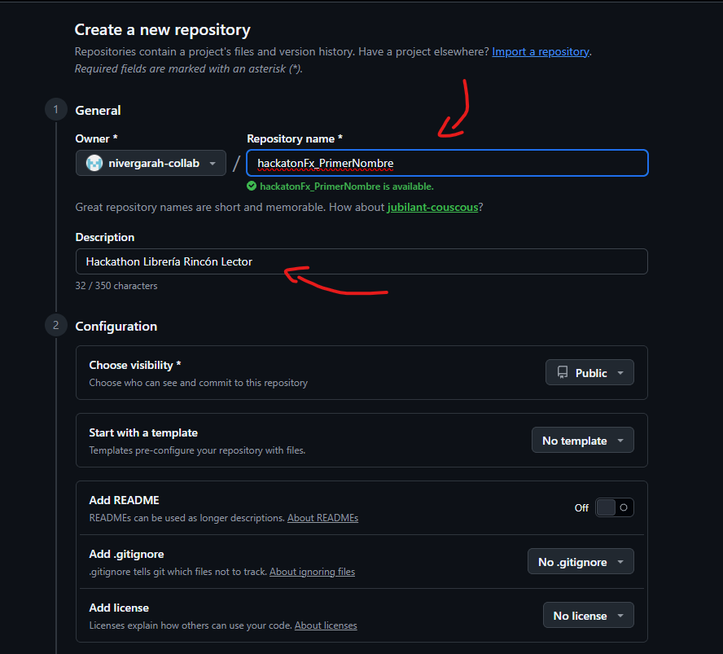
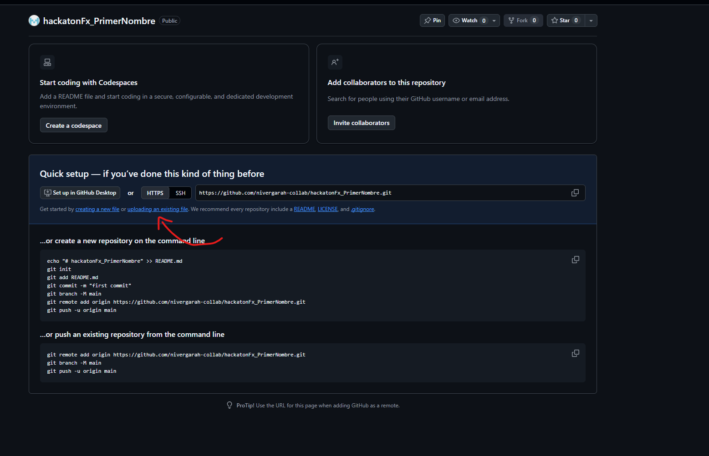
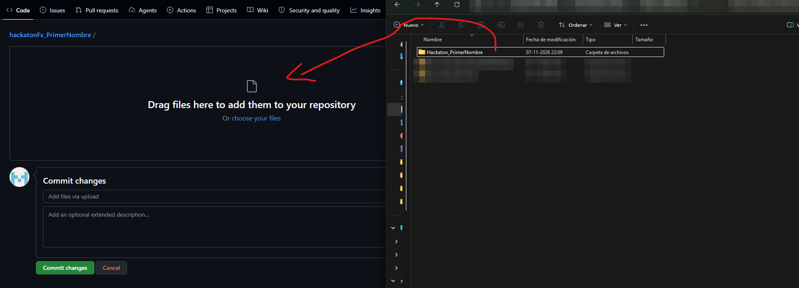
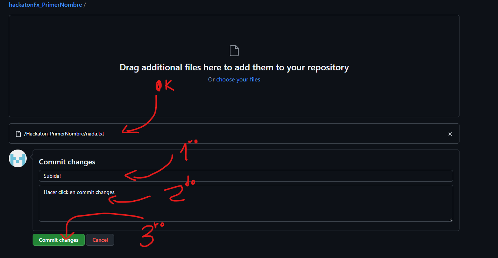
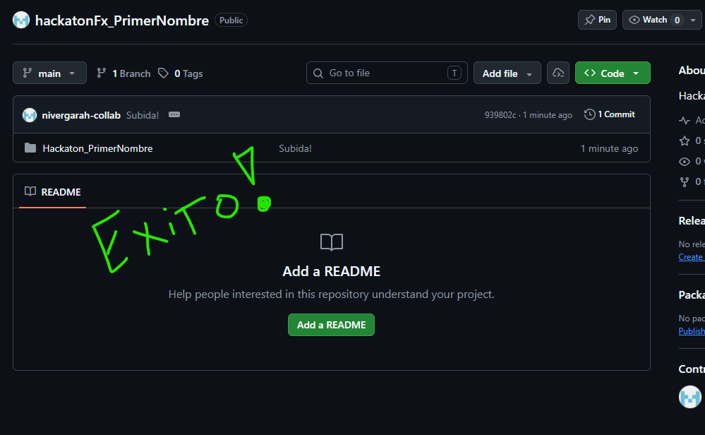

# Cómo crear tu repositorio y subir tu solución

Esta guía te muestra cómo subir tu proyecto a GitHub **sin usar comandos**: crearás un repositorio y arrastrarás tu carpeta. Te toma unos 5 minutos.

Necesitas una cuenta de GitHub. Si aún no tienes, créala antes en [github.com](https://github.com).

---

## Antes de empezar: prepara tu carpeta

1. Cierra IntelliJ.
2. Entra a la carpeta de tu proyecto y borra las carpetas `target` y `.idea`, si existen. No sirven para la revisión y hacen que la subida pese más.
3. Deja `libros.json` y `revistas.json` si los generaste al probar tu aplicación.

> GitHub permite subir hasta 100 archivos a la vez desde el navegador. Con `target` y `.idea` borradas, tu proyecto queda muy por debajo de ese límite.

---

## Paso 1 · Crear un repositorio nuevo

Entra a tu perfil de GitHub, abre la pestaña **Repositories** y haz clic en el botón verde **New**.



## Paso 2 · Completar los datos

Completa solo estos campos, igual que en la imagen:

- **Repository name:** `hackatonFx_` seguido de tu primer nombre, por ejemplo `hackatonFx_Camila`. Escríbelo sin tildes ni espacios.
- **Description:** opcional. Puedes escribir `Hackathon Librería Rincón Lector`.
- **Visibility:** debe ser **Public**. Si lo dejas privado, no podremos revisar tu trabajo.
- **Add README**, **Add .gitignore** y **Add license:** déjalos apagados, como vienen.

Luego baja hasta el final de la página y haz clic en el botón verde **Create repository**.



## Paso 3 · Elegir "uploading an existing file"

Verás una página con varios comandos. No los necesitas. Haz clic en el enlace **uploading an existing file**, que está debajo de la dirección del repositorio.



## Paso 4 · Arrastrar tu carpeta

Abre el Explorador de archivos, busca la carpeta de tu proyecto y arrástrala al recuadro **Drag files here to add them to your repository**.



Arrastra la **carpeta completa**, no los archivos de uno en uno. Así también se suben los archivos ocultos, como `.gitignore`.

## Paso 5 · Confirmar la subida

Espera a que termine la carga. Debes ver la lista de tus archivos, con sus rutas, bajo el recuadro. Luego:

1. Escribe un título en el primer campo de **Commit changes**, por ejemplo `Entrega hackathon`.
2. El segundo campo es opcional, puedes dejarlo vacío.
3. Haz clic en el botón verde **Commit changes**.



> En la imagen se subió un archivo de prueba llamado `nada.txt`. En tu caso verás los archivos de tu proyecto, como `pom.xml` y la carpeta `src`.

## Paso 6 · Revisar que quedó bien

Cuando termine, verás la página de tu repositorio con tu carpeta adentro.



Comprueba esto antes de enviar tu entrega:

- [ ] Junto al nombre del repositorio aparece la etiqueta **Public**.
- [ ] Al hacer clic en tu carpeta, ves `pom.xml` y la carpeta `src`.
- [ ] Dentro de `src`, llegas hasta tus clases y tu archivo FXML.

## Paso 7 · Copiar el enlace

Copia la dirección de la barra del navegador, mientras estás en la página principal de tu repositorio. Tendrá esta forma:

```
https://github.com/tu-usuario/hackatonFx_TuNombre
```

Ese es el enlace que debes poner en tu correo de entrega. Las instrucciones están en [`ENTREGA.md`](ENTREGA.md).

---

## Si algo salió mal

- **Subí la carpeta equivocada o me faltaron archivos:** en la página de tu repositorio haz clic en **Add file → Upload files** y arrastra lo que faltaba.
- **Quedó mal y quiero empezar de nuevo:** en tu repositorio ve a **Settings**, baja hasta el final de la página y usa **Delete this repository**. Luego repite desde el Paso 1.
- **El repositorio dice Private:** ve a **Settings**, baja hasta **Danger Zone** y elige **Change visibility → Make public**.

> Corrige cualquier problema **antes de la hora límite** de la entrega.
