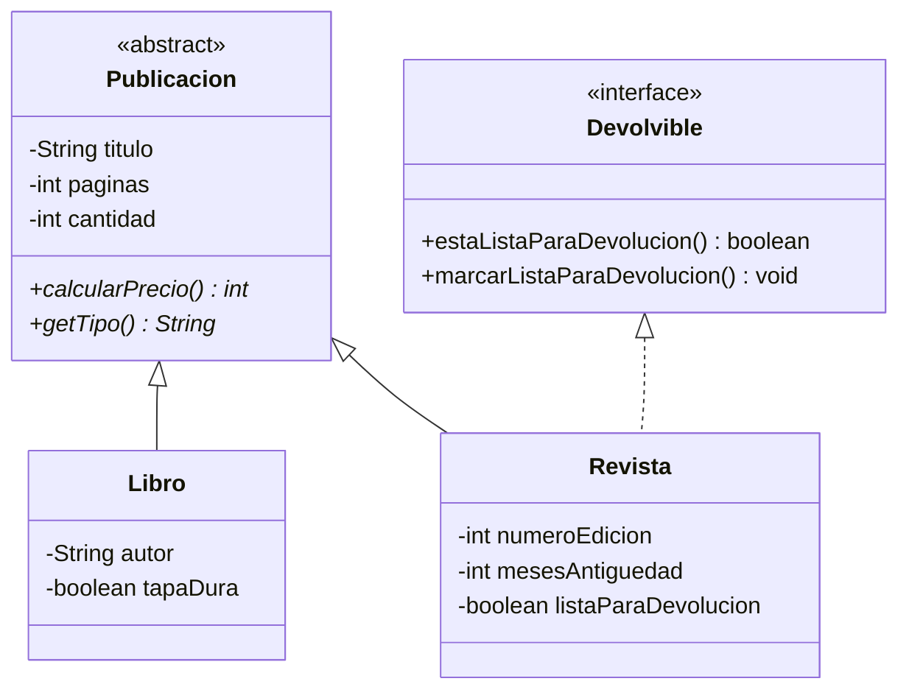

# Enunciado hackathon · Librería Rincón Lector

## Condiciones del ejercicio

**Del entorno y la entrega**

- El ejercicio es de carácter individual.
- El programa debe compilar y ejecutarse correctamente. Una solución que no compile no permite evidenciar ningún indicador de logro.
- La entrega se realiza como repositorio propio con tu solución, según las instrucciones del documento [`ENTREGA.md`](ENTREGA.md).

**De tu solución**

- El código debe organizarse en clases separadas, respetando las convenciones de nomenclatura de Java: PascalCase para nombres de clase, camelCase para métodos y atributos.
- Puedes crear métodos o clases auxiliares siempre que no contradigan los requerimientos del caso.
- Para que la práctica sirva, resuélvelo sin ayuda de herramientas de inteligencia artificial ni de soluciones ya hechas.

---

## 1. Contexto del caso

La Librería Rincón Lector ya cuenta con el modelo de clases desarrollado en una etapa anterior: el sistema distingue libros y revistas, calcula el precio unitario de cada publicación según su tipo y permite marcar las revistas como listas para devolución al proveedor. Sin embargo, ese sistema solo funciona por consola y la información se pierde cada vez que el programa se cierra.

La administración de la librería ha solicitado transformarlo en una aplicación de escritorio con ventanas, que permita al personal de bodega registrar y eliminar publicaciones, y que conserve la información en archivos para que esté disponible la próxima vez que se abra la aplicación.

### Proyecto base

El proyecto base es un proyecto Maven con la configuración inicial, la clase de arranque y el modelo ya implementado y probado, correspondiente al diagrama siguiente. Tu trabajo consiste en construir sobre ese modelo la interfaz gráfica y el almacenamiento en archivos. No debes reescribir ni reemplazar las clases entregadas.

El modelo entregado ya aplica las siguientes reglas:

- Libro: precio unitario base de $12.000. Si es de tapa dura, el precio se incrementa en un 30%.
- Revista: precio unitario base de $3.500. Si la edición tiene más de 6 meses de antigüedad, el precio se reduce en un 40%.

Datos comunes: el título no puede ser nulo ni vacío, las páginas deben estar entre 1 y 1500 y la cantidad en stock debe estar entre 1 y 300 unidades. Si un dato no cumple, el modelo lo rechaza con un mensaje que explica el motivo.

## 2. Estructura del proyecto

La solución debe separar responsabilidades según el patrón Modelo-Vista-Controlador, con una capa de acceso a datos basada en el patrón DAO/Repository. No hay una única forma de resolverlo: lo importante es que se cumplan los siguientes puntos.

- **Configuración del proyecto:** el proyecto base ya incluye las dependencias de JavaFX y la clase de arranque de la aplicación. Debes agregar al archivo `pom.xml` la dependencia de la librería Gson, necesaria para trabajar con archivos JSON, sin alterar lo que ya existe.
- **Vista:** la ventana se declara en un archivo FXML (por ejemplo, diseñado con Scene Builder) y se carga desde la clase de arranque. No se acepta una interfaz construida solo por código.
- **Vista y controlador:** el FXML indica su clase controladora, y cada componente que usa el controlador lleva `fx:id` en la vista y un atributo con el mismo nombre y tipo en el controlador, con la anotación `@FXML`.
- **Paquetes:** las clases se separan en paquetes distintos para controlador, modelo y persistencia, y el FXML va en los recursos. El modelo y la persistencia no dependen del controlador ni de clases de JavaFX. Las clases nuevas no van en el paquete raíz ni dentro del paquete del modelo.
- **Controlador:** valida las entradas y coordina la interfaz. Los cálculos y reglas del negocio (como el precio) los entrega el modelo, y las operaciones con los datos se piden al Repository. No lee ni escribe archivos directamente.
- **Persistencia (DAO/Repository):** una interfaz DAO con las operaciones de lectura y escritura; una implementación del DAO con Gson que maneje los archivos; y una clase Repository que mantenga las publicaciones en memoria, ofrezca las operaciones que usa el controlador y delegue en el DAO la lectura y escritura de archivos.

## 3. Ventana de la aplicación

Al ejecutar la aplicación se abre una única ventana, desde la cual se realizan todas las acciones. La ventana debe contener:

- Un formulario de registro con los campos descritos más abajo y un botón Registrar.
- Una tabla con las publicaciones registradas y las columnas Tipo, Título, Páginas, Cantidad y Precio unitario. El precio que se muestra es el que calcula el modelo para cada publicación.
  La tabla usa como fuente de datos una única lista observable, que se mantiene durante toda la ejecución y se actualiza al iniciar y tras cada registro o eliminación (no se crea una lista nueva cada vez). Debe mostrar libros y revistas sin duplicar ninguno.
- Un botón Eliminar, que quita del registro la publicación seleccionada en la tabla. Si no hay una fila seleccionada, la aplicación informa que se debe seleccionar una publicación y no realiza ningún cambio.
- Un área de mensajes dentro de la misma ventana, donde se informa el resultado de cada acción: registro exitoso, dato no válido, eliminación, falta de selección o error al leer o guardar los archivos. Cada mensaje identifica la publicación o la causa, y reemplaza al anterior. Los mensajes no se muestran por consola.

**Campos del formulario**

- Un selector de tipo con las opciones Libro y Revista.
- Datos comunes: título, páginas y cantidad.
- Datos del libro: autor y si es de tapa dura (sí/no).
- Datos de la revista: número de edición, antigüedad en meses y si está lista para devolución (sí/no).

Al cambiar el tipo en el selector, solo quedan habilitados los datos específicos del tipo elegido; los datos del otro tipo quedan deshabilitados y no se consideran al registrar.

Al presionar Registrar, la aplicación valida los datos según la sección 4. Si son correctos, registra la publicación, la tabla la muestra de inmediato, el área de mensajes informa la confirmación (por ejemplo: “Atlas del Sur (Libro) registrada correctamente.”) y el formulario queda vacío para un nuevo registro.

## 4. Validaciones del formulario

Antes de registrar, el formulario debe verificar los datos ingresados según las siguientes reglas:

- Tipo: debe estar seleccionado.
- Título: no puede estar vacío ni contener solo espacios.
- Páginas: número entero entre 1 y 1500.
- Cantidad: número entero entre 1 y 300.
- Autor (solo libro): no puede estar vacío ni contener solo espacios.
- Número de edición (solo revista): número entero entre 1 y 999.
- Antigüedad (solo revista): número entero de meses entre 0 y 120.

Las reglas de título, páginas y cantidad son las mismas que ya aplica el modelo entregado. Si algún dato no es válido:

- la publicación no se registra;
- el área de mensajes indica qué campo es incorrecto y por qué;
- los valores ya ingresados se mantienen para que puedan corregirse;
- la aplicación no se detiene ni muestra errores por consola.

## 5. Almacenamiento de la información

La información de las publicaciones debe conservarse entre una ejecución y otra, en formato JSON, en la carpeta raíz del proyecto:

- `libros.json`: contiene los libros registrados.
- `revistas.json`: contiene las revistas registradas.

El comportamiento esperado es el siguiente:

- Al iniciar, la aplicación carga automáticamente la información de ambos archivos y la muestra en la tabla.
- Si los archivos no existen (por ejemplo, la primera vez que se ejecuta), la aplicación inicia con la tabla vacía y sin mostrar errores.
- Cada vez que se registra o se elimina una publicación, los archivos se actualizan automáticamente, sin que el usuario deba presionar un botón para guardar.
- Lo que muestra la tabla y lo guardado en los archivos debe coincidir en todo momento.
- Si no se puede leer o guardar un archivo, el área de mensajes lo informa. Si falla un guardado, no se informa éxito y el cambio no se aplica, de modo que la tabla y los archivos siguen coincidiendo.

## 6. Datos de prueba y resultado esperado

Registra desde la aplicación las siguientes publicaciones:

| Tipo | Título | Páginas | Cantidad | Datos específicos | Precio unitario |
|---|---|---|---|---|---|
| Libro | Atlas del Sur | 320 | 5 | Autor: A. Rivas \| Tapa dura: sí | $15.600 |
| Libro | Bosque Adentro | 200 | 10 | Autor: M. Soto \| Tapa dura: no | $12.000 |
| Revista | Ciencia Hoy | 60 | 25 | Edición: 12 \| Antigüedad: 2 meses \| Devolución: no | $3.500 |
| Revista | Viajes | 80 | 8 | Edición: 3 \| Antigüedad: 9 meses \| Devolución: sí | $2.100 |

Luego de registrarlas, la ventana debe mostrar las cuatro publicaciones con sus precios. Si se presiona Eliminar sin seleccionar una fila, el aviso aparece en la misma ventana.

Si un dato del formulario no es válido (por ejemplo, unas páginas `abc` o una cantidad `0`), el área de mensajes indica el campo con problemas y se mantienen los valores ingresados.

**Verificación de almacenamiento**

- Cierra la aplicación y vuelve a abrirla: la tabla debe mostrar las mismas cuatro publicaciones, y la revista Viajes debe seguir lista para devolución.
- Elimina Bosque Adentro, cierra la aplicación y vuelve a abrirla: Bosque Adentro ya no debe aparecer.
